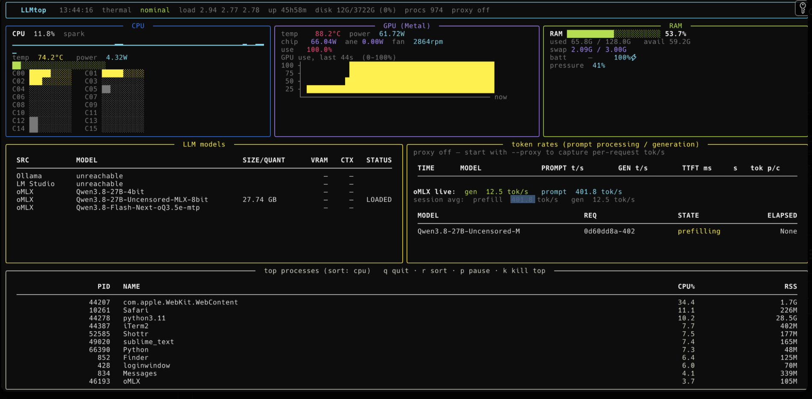

# llmtop

htop for your LLM Mac. One terminal screen showing what your Apple Silicon machine is doing while it runs local models.



## What it shows

- **CPU / GPU / RAM**: temperatures, power draw, fan speed, memory pressure, per-core load, and a GPU utilization history chart (via [macmon](https://github.com/vladkens/macmon), no sudo)
- **Loaded models** from oMLX, Ollama, and LM Studio
- **Token rates**: prompt processing and generation tok/s, from oMLX session stats and/or an optional capture proxy
- **System health**: swap, battery, thermal state, disk, load, uptime
- **Top processes**, sortable by CPU or memory

## Requirements

- An Apple Silicon Mac
- Python 3.10 or newer
- `macmon` for temperature, power, and GPU metrics (llmtop still runs without it, with those panels empty)

## Install

```sh
brew install macmon pipx
pipx install git+https://github.com/gregheffner/llmtop
```

## Usage

```sh
llmtop                 # monitor everything it finds
llmtop --once          # print one snapshot and exit
llmtop --version
```

llmtop looks for servers on their default local ports and shows whichever are running:

| Server    | Default address          | Change with    | Disable with    |
|-----------|--------------------------|----------------|-----------------|
| oMLX      | `http://127.0.0.1:8000`  | `--omlx URL`   | `--no-omlx`     |
| Ollama    | `http://127.0.0.1:11434` | `--ollama URL` | `--no-ollama`   |
| LM Studio | `http://127.0.0.1:1234`  | `--lmstudio URL` | `--no-lmstudio` |

### Keys

| Key | Action |
|-----|--------|
| `q` | quit |
| `r` | toggle process sort (CPU / memory) |
| `p` | pause / resume |
| `k` | kill the top process (asks for `y` to confirm) |

### oMLX API key

If your oMLX admin API needs a key, set it in your environment rather than on the command line, so it stays out of your shell history:

```sh
export OMLX_API_KEY="your-key-here"
llmtop
```

`--omlx-key` also works. llmtop only sends the key to the oMLX address you configure.

### Per-request token rates (capture proxy)

Ollama and LM Studio don't expose live tok/s, so llmtop can run a small local proxy that sits between your client and the server and records each request's stats:

```sh
llmtop --proxy                                    # 127.0.0.1:11500 -> Ollama on 11434
llmtop --proxy --upstream http://127.0.0.1:8000   # proxy to oMLX instead
llmtop --proxy --proxy-port 9000                  # use a different listen port
```

Then point your client at `http://127.0.0.1:11500` instead of the server's own address. The proxy listens on localhost only and passes requests through unchanged, including streaming responses.

Generation tok/s for OpenAI-style servers is shown only when the server reports it in its response.

## Development

```sh
git clone https://github.com/gregheffner/llmtop
cd llmtop
python3 -m venv .venv && .venv/bin/pip install -e .
.venv/bin/llmtop --once
```
